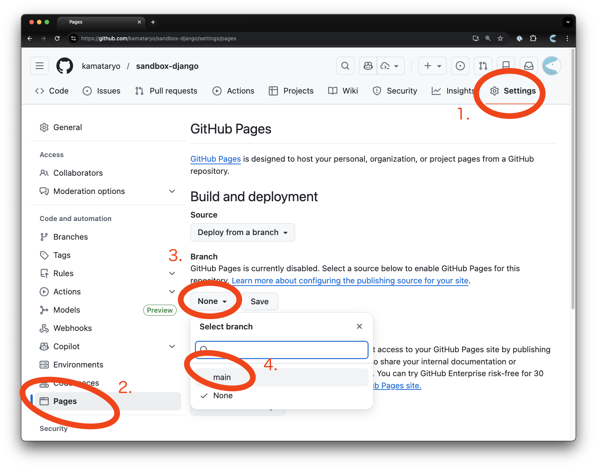

<style>
.cols { display: flex; gap: 24px; align-items: center; }
.cols > div { flex: 1; min-width: 0; }
</style>

<!-- _class: title -->

# オープンデータで始める<br />ウェブカートグラフィ入門

## 第11回: 応用プロジェクト（1）地図プロジェクトの企画<br />テーマを決めて、ウェブに公開する

立命館大学 2026年度 秋セメスター 火曜5限
授業時間: 95分

---

## 本日のアジェンダ

1. **前回の振り返り・課題の確認** (10分)
2. **仮のテーマを見直して、決める** (20分)
3. **Git と GitHub** (15分)
4. **実習1: プロジェクトを GitHub に置いて、公開する** (25分)
5. **実習2: 企画を README に書く** (15分)
6. **まとめ・課題** (10分)

---

<style scoped>section { font-size: 26px; }</style>

## 前回の振り返り

### 第10回の主要ポイント

- ベクトルタイルは、データをタイルに分けて PBF で小さくまとめたもの
- ベースマップも Layer の集まり。Maputnik で観察・編集できる
- ベースマップは**脇役**。自分のデータが伝わるように、引く

### 課題の確認

調整する前と後の地図を見せてください

- ベースマップの何を、なぜ変えたか
- 自分のデータは、見やすくなった？

---

## ここまでにできるようになったこと

| 回 | できること |
|--|--|
| 第3-4回 | OpenStreetMap からデータを取り出す |
| 第5回 | GeoJSON を作る・読む |
| 第7回 | ベースマップを選んで、地図ページを作る |
| 第8回 | 自分のデータを重ねて、クリックで情報を出す |
| 第9回 | `properties` で描き分ける |
| 第10回 | ベースマップをテーマに合わせる |

=> 地図プロジェクトを作る道具は、そろった

---

## これからの進め方

| 回 | 内容 |
|--|--|
| **第11回（今日）** | テーマを決める。ウェブに公開する |
| 第12回 | 地図を仕上げる。発表の準備 |
| 第13-14回 | 発表 |

今日から、課題は **URL** で提出します

---

<style scoped>section { font-size: 26px; }</style>

## 仮のテーマを見直す

第6回で決めた仮のテーマを、もう一度見てみましょう

第6回では、**実現可能性**は考えなかった。今なら判断できる

| 観点 | 確かめること |
|--|--|
| **データ** | 手に入るか。自分で作るなら、何件くらいか |
| **ライセンス** | 公開してよいデータか。出典表記はどう書くか |
| **表現** | 授業で扱った範囲で描けるか。足りない部分は何か |
| **時間** | 第12回までに形になるか |

テーマは変えてもよい。ここまでの課題で作った地図が、そのまま土台になる

---

## 企画を言葉にする

次の問いに、一言ずつ答える

- **誰に**見てもらう地図か
- 見た人に、**何が伝わる**とよいか
- **どのデータ**を使うか（入手先、ライセンス）
- **どのベースマップ**の上に、**どう描き分ける**か
- 見た人は、地図で**何ができる**か（クリック、絞り込み、移動など）

一緒に話しながら決めていきます。答えは、あとで README に書きます

---

## 大きくしすぎない

- まず、**小さく完成**させる
  （1つのデータ、1つの描き分け、ポップアップ）
- 動くものができてから、足していく
- 「できたらやりたいこと」は、別に書き出しておく

=> 第12回の終わりに、**人に見せられる状態**になっていることが目標

---

## Git と GitHub

第9回: 「動いている状態のフォルダを、コピーして残しておく」

```text
map/
map-コピー/
map-コピー2/
map-最新/
map-最新-直した/
```

- どれが動いていたのか、わからなくなる
- 何を変えたのかも、わからない

=> この「コピーして残す」を、きちんとやってくれる道具が **Git**

---

<style scoped>section { font-size: 26px; }</style>

## Git: 変更の履歴を記録する

<div class="cols">
<div>

- **リポジトリ**
  履歴ごと管理されているフォルダ
- **コミット**
  その時点の状態を記録したもの。ゲームの**セーブポイント**にあたる
- **コミットメッセージ**
  何を変えたかの一言メモ

コミットしておけば、いつでもその時点に**戻れる**

</div>
<svg width="480" height="300" viewBox="0 0 480 300" xmlns="http://www.w3.org/2000/svg" font-family="sans-serif" role="img" aria-label="コミットが時間の順に4つ並んでいる図。ベースマップを表示、データを重ねる、色分けする、凡例を足す、と積み重なり、過去のコミットに戻ることもできる">
  <defs><marker id="git-back" viewBox="0 0 10 10" refX="9" refY="5" markerWidth="7" markerHeight="7" orient="auto"><path d="M0,0 L10,5 L0,10 z" fill="#b3261e"/></marker></defs>
  <line x1="40" y1="40" x2="40" y2="260" stroke="#2f6fbf" stroke-width="4"/>
  <circle cx="40" cy="40" r="12" fill="#dcecff" stroke="#2f6fbf" stroke-width="3"/>
  <text x="70" y="38" font-size="17" font-weight="bold" fill="#333">ベースマップを表示</text>
  <text x="70" y="58" font-size="13" fill="#666">第7回</text>
  <circle cx="40" cy="113" r="12" fill="#dcecff" stroke="#2f6fbf" stroke-width="3"/>
  <text x="70" y="111" font-size="17" font-weight="bold" fill="#333">データを重ねる</text>
  <text x="70" y="131" font-size="13" fill="#666">第8回</text>
  <circle cx="40" cy="186" r="12" fill="#dcecff" stroke="#2f6fbf" stroke-width="3"/>
  <text x="70" y="184" font-size="17" font-weight="bold" fill="#333">カテゴリーで色分けする</text>
  <text x="70" y="204" font-size="13" fill="#666">第9回</text>
  <circle cx="40" cy="260" r="12" fill="#2f6fbf" stroke="#2f6fbf" stroke-width="3"/>
  <text x="70" y="258" font-size="17" font-weight="bold" fill="#333">凡例を足す</text>
  <text x="70" y="278" font-size="13" fill="#666">今の状態</text>
  <path d="M330,256 C440,240 440,130 300,113" fill="none" stroke="#b3261e" stroke-width="2" stroke-dasharray="6 4" marker-end="url(#git-back)"/>
  <text x="375" y="190" font-size="14" text-anchor="middle" fill="#b3261e">戻れる</text>
</svg>
</div>

---

## AI と作るときこそ、Git

- AI は、一度に**たくさんのファイル**を書き換える
- 直すつもりが、動いていたところまで壊れることがある（第9回）

### 進め方

1. 動いた => **コミットする**
2. AI に次のことを頼む
3. 動いた => コミットする / 壊れた => **前のコミットに戻す**

=> 戻れるとわかっていれば、思い切って試せる

---

## GitHub: リポジトリをウェブに置く

- **Git**: 履歴を記録する**道具**。自分のパソコンの中で動く
- **GitHub**: Git のリポジトリを**ウェブに置いておく場所**

### GitHub に置くと

- パソコンが壊れても、履歴ごと残る
- URL で人に見せられる（課題の提出も URL で済む）
- **GitHub Pages** で、ウェブページとして公開できる

MapLibre GL JS も tippecanoe も、GitHub で開発されている（第7回・第10回）

---

<style scoped>section { font-size: 24px; }</style>

## 全体の流れ

<svg width="1100" height="250" viewBox="0 0 1100 250" xmlns="http://www.w3.org/2000/svg" font-family="sans-serif" role="img" aria-label="自分のパソコンの中の作業フォルダでファイルを編集し、コミットしてリポジトリに記録する。プッシュすると GitHub のリポジトリに届き、GitHub Pages がそれをウェブページとして公開する、という流れの図">
  <defs><marker id="flow-arrow" viewBox="0 0 10 10" refX="9" refY="5" markerWidth="7" markerHeight="7" orient="auto"><path d="M0,0 L10,5 L0,10 z" fill="#666"/></marker></defs>
  <rect x="1" y="30" width="560" height="200" rx="10" fill="none" stroke="#999" stroke-width="1.5" stroke-dasharray="6 4"/>
  <text x="18" y="22" font-size="16" font-weight="bold" fill="#333">自分のパソコン</text>
  <rect x="640" y="30" width="459" height="200" rx="10" fill="none" stroke="#999" stroke-width="1.5" stroke-dasharray="6 4"/>
  <text x="657" y="22" font-size="16" font-weight="bold" fill="#333">GitHub</text>
  <rect x="24" y="70" width="210" height="130" rx="8" fill="#fff4d6" stroke="#c99a00" stroke-width="2"/>
  <text x="129" y="98" font-size="17" font-weight="bold" text-anchor="middle" fill="#7a5d00">作業フォルダ</text>
  <text x="129" y="130" font-size="14" font-family="monospace" text-anchor="middle" fill="#333">index.html</text>
  <text x="129" y="152" font-size="14" font-family="monospace" text-anchor="middle" fill="#333">data.geojson</text>
  <text x="129" y="174" font-size="14" font-family="monospace" text-anchor="middle" fill="#333">style.json</text>
  <line x1="237" y1="135" x2="322" y2="135" stroke="#666" stroke-width="2" marker-end="url(#flow-arrow)"/>
  <text x="281" y="125" font-size="15" font-weight="bold" text-anchor="middle" fill="#333">コミット</text>
  <rect x="330" y="70" width="210" height="130" rx="8" fill="#dcecff" stroke="#2f6fbf" stroke-width="2"/>
  <text x="435" y="98" font-size="17" font-weight="bold" text-anchor="middle" fill="#1d4f8f">リポジトリ</text>
  <line x1="375" y1="145" x2="495" y2="145" stroke="#2f6fbf" stroke-width="3"/>
  <circle cx="375" cy="145" r="8" fill="#fff" stroke="#2f6fbf" stroke-width="3"/>
  <circle cx="435" cy="145" r="8" fill="#fff" stroke="#2f6fbf" stroke-width="3"/>
  <circle cx="495" cy="145" r="8" fill="#2f6fbf" stroke="#2f6fbf" stroke-width="3"/>
  <text x="435" y="180" font-size="13" text-anchor="middle" fill="#666">履歴</text>
  <line x1="543" y1="135" x2="656" y2="135" stroke="#666" stroke-width="2" marker-end="url(#flow-arrow)"/>
  <text x="600" y="125" font-size="15" font-weight="bold" text-anchor="middle" fill="#333">プッシュ</text>
  <rect x="664" y="70" width="190" height="130" rx="8" fill="#dcecff" stroke="#2f6fbf" stroke-width="2"/>
  <text x="759" y="98" font-size="17" font-weight="bold" text-anchor="middle" fill="#1d4f8f">リポジトリ</text>
  <line x1="709" y1="145" x2="809" y2="145" stroke="#2f6fbf" stroke-width="3"/>
  <circle cx="709" cy="145" r="8" fill="#fff" stroke="#2f6fbf" stroke-width="3"/>
  <circle cx="759" cy="145" r="8" fill="#fff" stroke="#2f6fbf" stroke-width="3"/>
  <circle cx="809" cy="145" r="8" fill="#2f6fbf" stroke="#2f6fbf" stroke-width="3"/>
  <text x="759" y="180" font-size="13" text-anchor="middle" fill="#666">履歴</text>
  <line x1="857" y1="135" x2="902" y2="135" stroke="#666" stroke-width="2" marker-end="url(#flow-arrow)"/>
  <rect x="910" y="70" width="170" height="130" rx="8" fill="#e3f4e1" stroke="#3c8d3c" stroke-width="2"/>
  <text x="995" y="98" font-size="17" font-weight="bold" text-anchor="middle" fill="#2c6b2c">GitHub Pages</text>
  <rect x="924" y="118" width="142" height="26" rx="4" fill="#fff" stroke="#999"/>
  <text x="995" y="136" font-size="11" font-family="monospace" text-anchor="middle" fill="#2c6b2c">https://〜.github.io/〜</text>
  <text x="995" y="176" font-size="13" text-anchor="middle" fill="#666">誰でも見られる</text>
</svg>

- **コミット**: 自分のパソコンの中で、状態を記録する
- **プッシュ**: 記録した履歴を、GitHub に送る
- **GitHub Pages**: GitHub に届いたファイルを、ウェブページとして公開する

---

## 公開する前に確かめること

GitHub Pages で公開すると、**世界中の誰でも**見られる。ファイルの中身も、履歴も見られる

- **個人の情報**が入っていないか
  （自宅や友人の家の位置、名前、顔の写った写真。GeoJSON の `properties` も見る）
- **公開してよいデータ**か
  （ライセンスを確かめる。出典表記はあるか）
- **API キー**などの秘密の文字列が入っていないか（第7回）

一度プッシュしたものは、あとから消しても**履歴に残る**

---

## 実習1: プロジェクトを GitHub に置いて、公開する（25分）

### ゴール

これまでに作った地図が、自分のパソコン以外からも URL で見られる

### 進め方

1. フォルダを整える
2. Git で管理して、最初のコミットを作る
3. GitHub にプッシュする
4. GitHub Pages を有効にする
5. 変更して、もう一度プッシュする

---

<style scoped>section { font-size: 26px; }</style>

## ステップ1: フォルダを整える

プロジェクト用のフォルダを1つ決めて、必要なファイルだけを入れる

```text
my-map/
├── index.html
├── data.geojson
└── style.json
```

- HTML ファイルの名前は **`index.html`** にする
  （GitHub Pages は、`index.html` を最初のページとして表示する）
- フォルダの名前は、**半角の英数字とハイフン**にする（URL の一部になる）
- 古いコピーや、使っていないファイルは入れない
- ローカルサーバーで開いて、地図が出ることを確かめる

---

<style scoped>section { font-size: 26px; }</style>

## ステップ2: 最初のコミットを作る

フォルダを AI コーディングツールで開いて、頼む

```text
このパソコンで Git が使えるか確かめてください。
使えるなら、このフォルダを Git で管理して、今の状態をコミットしてください。
```

- Git が入っていないときは、入れ方を AI に聞く
- 名前とメールアドレスの設定を求められたら、GitHub に登録したものを使う

### 確かめる

エディタの**ソース管理**の画面を開く。コミットが1つできている？

---

<style scoped>section { font-size: 24px; }</style>

## AI が実行しているコマンド

Git の操作は**コマンド**でできている。覚えなくて OK。**読める**ようになろう

```shell
# このフォルダを Git で管理する（最初に1回だけ）
git init

# 記録するファイルを選ぶ（. は「全部」）
git add .

# コミットを作る。-m のあとはコミットメッセージ
git commit -m "ベースマップとデータを表示する地図を追加"

# GitHub に送る
git push origin main
```

`main` は、履歴の本線の名前（**ブランチ**）

エディタのソース管理の画面でも、同じことがボタンでできる

---

<style scoped>section { font-size: 26px; }</style>

## ステップ3: GitHub にプッシュする

1. エディタの**ソース管理**の画面で、**Publish to GitHub** を選ぶ
2. ブラウザが開いたら、GitHub にログインして許可する
3. **Public**（公開）のリポジトリを選ぶ

うまくいかないときは、AI に「このフォルダを GitHub の公開リポジトリにプッシュしたい」と頼み、出てきた手順に従う

### 確かめる

ブラウザで `https://github.com/<ユーザー名>/<リポジトリ名>` を開く

- ファイルは並んでいる？
- コミットメッセージは、どこに出ている？

---

## ステップ4: GitHub Pages を有効にする

1. GitHub のリポジトリのページで、**Settings** を開く
2. 左のメニューから **Pages** を選ぶ
3. **Branch** で `main` を選び、**Save** を押す
4. 1〜2分待って、次の URL を開く

```text
https://<ユーザー名>.github.io/<リポジトリ名>/
```

※ 次のページのスクリーンショットを参照

---



---

## ステップ5: 変更して、もう一度プッシュする

1. 地図を少し変える（色を1つ変える、など）
2. ローカルサーバーで確かめる
3. コミットして、プッシュする

```text
今の変更をコミットして、GitHub にプッシュしてください。
```

4. 1〜2分待って、GitHub Pages の URL を開き直す

=> **プッシュするだけ**で、公開されているページが更新される

---

<style scoped>section { font-size: 26px; }</style>

## うまくいかないとき

| 症状 | 確かめること |
|--|--|
| Pages の URL が 404 になる | `index.html` という名前か。リポジトリは Public か。数分待ったか |
| 地図は出るが、データが出ない | `data.geojson` の場所の書き方。`/data.geojson` ではなく `./data.geojson` |
| プッシュしたのに変わらない | 数分待つ。ブラウザを再読み込みする。GitHub の **Actions** タブで進み具合を見る |
| プッシュでエラーになる | エラーの文章をそのまま AI に貼る |
| 壊れたので戻したい | AI に「直前のコミットの状態に戻してください」と頼む |

GitHub Pages の[利用上の制限](https://docs.github.com/ja/pages/getting-started-with-github-pages/github-pages-limits)も一読してください

---

## よいコミットのコツ

- **動いた**ら、コミットする
- 1つのコミットには、**1つの変更**
- コミットメッセージは、**何を変えたか**を書く

| わかりにくい | わかりやすい |
|--|--|
| 修正 | カフェのポップアップに営業時間を追加 |
| いろいろ変えた | ベースマップを positron に変更 |
| 最新 | 凡例の色を地図の色に合わせる |

メッセージは、AI に書いてもらってもよい。**内容が合っているか**は自分で読む

---

<style scoped>section { font-size: 26px; }</style>

## 実習2: 企画を README に書く（15分）

`README.md` は、リポジトリの**説明書**。GitHub のリポジトリのページに表示される

フォルダに `README.md` を作り、今日決めた企画を書く

```markdown
# （地図のタイトル）

（公開している URL）

## 誰に、何を伝える地図か

## 使うデータと出典

## 地図の見せ方（ベースマップ、描き分け、操作）

## できたらやりたいこと
```

書けたら、**コミットしてプッシュ**する

---

## まとめ

- 仮のテーマを、データ・ライセンス・表現・時間の観点で見直して決めた
- **Git** は変更の履歴を記録する道具。**コミット**はセーブポイント
- **GitHub** はリポジトリをウェブに置く場所。**プッシュ**で送る
- **GitHub Pages** で、地図を URL で公開できる
- 公開する前に、個人の情報・ライセンス・秘密の文字列を確かめる
- 動いたらコミットする。壊れたら戻す

---

<div class="assignment">

## 課題: プロジェクトのテーマと概要を提出する

### 課題内容

地図プロジェクトを GitHub に置いて、GitHub Pages で公開してください。

- `README.md` に、今日決めた企画が書かれていること
- GitHub Pages の URL で、作りかけの地図（プロトタイプ）が表示されること
- テーマのデータが、少なくとも一部は地図に表示されていること
- 今日の授業のあとに、コミットを3つ以上足すこと

</div>

---

<style scoped>section { font-size: 26px; }</style>

<div class="assignment">

### 提出要項

- **提出物**:
  - GitHub リポジトリの URL
  - GitHub Pages の URL
- **提出期限**: 次回授業開始時
- **提出方法**: moodle+R 経由
- **評価ポイント**: 企画の具体性、データの入手先とライセンスの確認、公開された地図が表示されること、コミットメッセージから変更の内容がわかるか

</div>

---

## 質疑応答

### 本日の内容について
- 授業内容に関する質問
- 課題に関する質問

### 連絡先
- moodle+R

---

<!-- _class: title -->

# ありがとうございました

## 次回もよろしくお願いします

**第12回: 応用プロジェクト（2）地図プロジェクトの完成**
